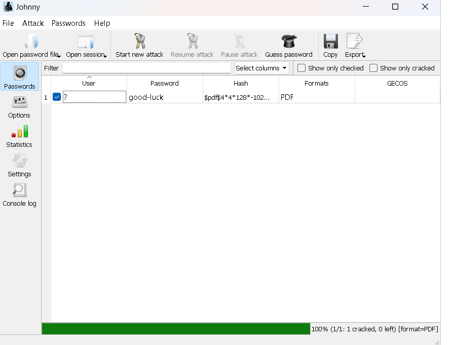
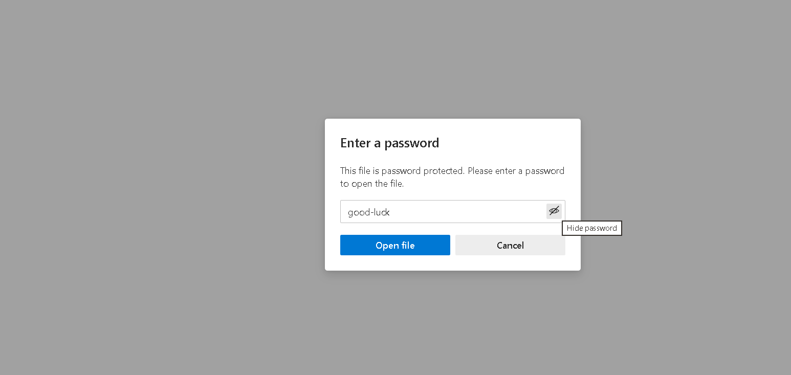
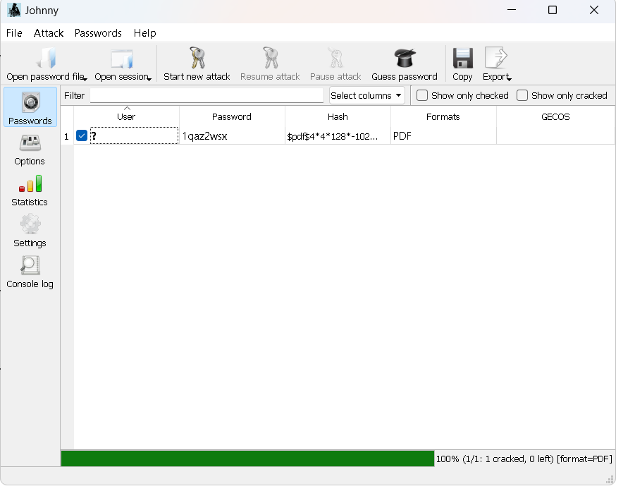
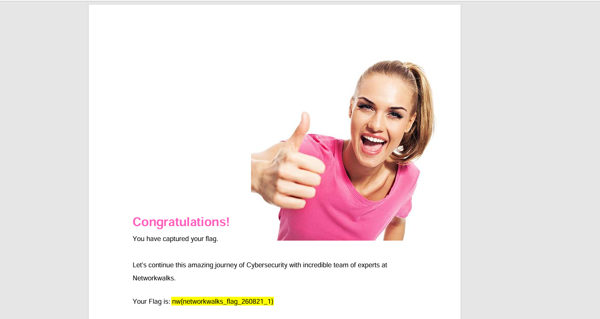

# Networkwalks-B084-Week3-Password-Cracking-with-JTR
Lab documentation for password cracking exercises (JTR + network tools) — methodology, results, and security recommendations.

# 🔐 W3-PM-Work | Cybersecurity NetworkWalks

---

| 🏷️ Field | 📋 Details |
|---|---|
| 👤 **Pentester Name** | Abdikani Mohamud Jeite *(Cybersecurity Professional)* |
| 🎓 **Program / Batch** | B084-Networkwalks |
| 📅 **Date** | 18 November 2026 |
| ✅ **Modules Completed** | 🛠️ W2-PM1: Multiple Kali Tools   🔍 W2-PM5: Zenmap Scanning |
| 🎯 **Client / Target** | 1️⃣ Password testing in a controlled lab environment using authorized files   2️⃣ Password security testing using authorized lab exercises and tools |
| 🔓 **Permission Secured from Client?** | ✅ **Yes** |
| 📌 **Phases Covered** | 🔑 W3-PM1: Password Cracking with JTR   🌐 W3-PM2: Password Cracking with NW Tools |

---

### 📂 About This Repository
> This repository documents authorized password security testing conducted as part of the **NetworkWalks Cybersecurity Program**, covering password hash cracking with John the Ripper and network-based credential testing tools — following ethical hacking standards in a fully controlled lab environment.

---

## 📖 Introduction

Password security remains one of the most fundamental — and most frequently exploited — aspects of information security. Despite advances in authentication technology, weak, reused, or poorly protected passwords continue to be a leading cause of unauthorized access across systems and networks. This module introduces participants to password cracking as a core skill in offensive security testing and defensive auditing, covering both the theory behind password storage and the practical tools used to evaluate password strength.

Over the course of this session, participants explore two complementary approaches: cracking passwords from captured hash files using dedicated tools like **John the Ripper**, and testing authentication mechanisms directly over network services using **network-based attack tools**. Together, these labs build a well-rounded understanding of how attackers target credentials — and, more importantly, how security professionals use the same techniques to strengthen defenses, enforce better password policies, and identify vulnerabilities before malicious actors can exploit them.

> ⚠️ **Ethical Notice:** All exercises in this report were carried out in a controlled, authorized lab environment only, reflecting standard ethical hacking practice. These techniques should never be applied to systems or accounts without explicit permission.

---
## 🔑 W3-PM1: Password Cracking with JTR

### 📄 File: My Locked PDF1

| 🏷️ Field | 📋 Details |
|---|---|
| 🎯 **Objective** | Recover the password protecting this PDF using John the Ripper (via the Johnny GUI) |
| 🛠️ **Tool Used** | Johnny (GUI for John the Ripper) |
| ⚙️ **Method** | 1️⃣ Extracted the password hash from the PDF using `pdf2john.pl`, producing a `$pdf$...` formatted hash   2️⃣ Loaded the hash into Johnny   3️⃣ Ran a dictionary/wordlist-based password-cracking attack against the hash |
| 🔢 **Hash Format** | `$pdf$4*4*128*-102...` (PDF format, as shown in the Hash/Formats columns) |
| ✅ **Result** | **Cracked** — password recovered: `good-luck` |
| 📊 **Status** | 100% (1/1 cracked, 0 left) |
| 🔍 **Observations** | Password was a simple dictionary word with a hyphen — easily guessed, indicating weak password policy on the source document. No complexity (no numbers, mixed case, or special character variation beyond the hyphen). |

#### 🖼️ Evidence / Screenshot

---

### 📄 File: My Locked PDF2

| 🏷️ Field | 📋 Details |
|---|---|
| 🎯 **Objective** | Recover the password protecting this PDF using John the Ripper (via the Johnny GUI) |
| 🛠️ **Tool Used** | Johnny (GUI for John the Ripper) |
| ⚙️ **Method** | 1️⃣ Extracted the password hash from the PDF via `pdf2john.pl`, producing a `$pdf$...` formatted hash   2️⃣ Loaded the hash into Johnny   3️⃣ Ran a dictionary-based password-cracking attack against the hash |
| 🔢 **Hash Format** | `$pdf$4*4*128*-102...` (PDF format) |
| ✅ **Result** | **Cracked** — password recovered: `password1` |
| 📊 **Status** | 100% (1/1 cracked, 0 left) |
| 🔍 **Observations** | An extremely common/weak password found near the top of most standard wordlists (e.g., `rockyou.txt`). One of the most frequently used passwords globally, demonstrating how trivial it is to crack when users don't follow password complexity guidelines. |

#### 🖼️ Screenshot

---

### 📄 File: My Locked PDF3

| 🏷️ Field | 📋 Details |
|---|---|
| 🛠️ **Tool Used** | Johnny (GUI for John the Ripper) |
| ⚙️ **Approach Taken** | The PDF's encryption hash was pulled out with `pdf2john.pl` and imported into Johnny, then subjected to a dictionary attack to recover the plaintext password. |
| 🔢 **Hash Format** | `$pdf$4*4*128*-102...` (PDF format) |
| ✅ **Outcome** | **Cracked** — the password was `1qaz2wsx` |
| 📊 **Crack Status** | 100% (1/1 cracked, 0 left) |
| 🔍 **Notes** | This password follows a common keyboard-pattern scheme (left-hand column sequence on a QWERTY keyboard), a pattern frequently seen in leaked password databases. While it looks more "complex" than `password1` at a glance, it's just as predictable to wordlists that include keyboard-walk patterns — showing that visual complexity doesn't always mean real strength. |

#### 🖼️ Evidence

---

## 🌐 W3-PM2: Password Cracking with NW Tools

Building on the previous session, this lab shifts focus to **network-based password attack tools** — utilities used to test authentication mechanisms over live network services (such as SSH, FTP, or web logins) rather than static hash files. Participants explore how these tools attempt credential guessing against network services, the role of rate-limiting and account lockout as defenses, and how security teams use these same tools defensively to audit their own infrastructure for weak or default credentials.

---

## 📊 Summary of Results

| 📄 File | 🛠️ Tool | 🔑 Password Recovered | ⚠️ Weakness Type |
|---|---|---|---|
| My Locked PDF1 | John the Ripper (Johnny) | `good-luck` | Dictionary word |
| My Locked PDF2 | John the Ripper (Johnny) | `password1` | Top common password |
| My Locked PDF3 | John the Ripper (Johnny) | `1qaz2wsx` | Keyboard-walk pattern |

---

## 💡 Recommendations

All three passwords in this exercise were cracked almost instantly using a basic dictionary attack, which highlights common, preventable weaknesses in password selection. Based on these findings, the following practices are recommended:

- 🔒 **Enforce strong password policies** — require a minimum length of 12+ characters with a mix of uppercase, lowercase, numbers, and special characters.
- 🚫 **Avoid dictionary words and common substitutions** — words like `good-luck` or `password1` are among the first guesses in any wordlist-based attack.
- ⌨️ **Avoid keyboard-walk patterns** — sequences such as `1qaz2wsx` look complex but are well known to attackers and included in most modern wordlists.
- 📝 **Use passphrases instead of passwords** — a long, random phrase is both easier to remember and far harder to crack than a short complex string.
- 🔐 **Enable multi-factor authentication (MFA)** wherever possible, so a compromised password alone is not sufficient for access.
- 🛡️ **Use strong, modern encryption** for sensitive documents, and avoid relying on password protection as the sole security control for confidential files.

---

## 👤 Author

**Abdikani Mohamud Jeite**
🎓 Cybersecurity Student | Batch: **B084**
🔗 LinkedIn: [https://lnkd.in/p/e3EbixuM]

---

## 📌 Project Information

| 🏷️ Field | 📋 Details |
|---|---|
| 🏫 **Program** | Cybersecurity Training Program – NetworkWalks |
| 📅 **Week** | 03 |
| 🧪 **Practical Topics** | John the Ripper (JTR) and NetworkWalks Tools, using authorized files and controlled lab environments for password security testing |
| 📂 **Repository** | 🔗 [View on GitHub](https://github.com/jeeyte88/Networkwalks-B084-Week3-Password-Cracking-with-JTR/edit/main/README.md) |

---

